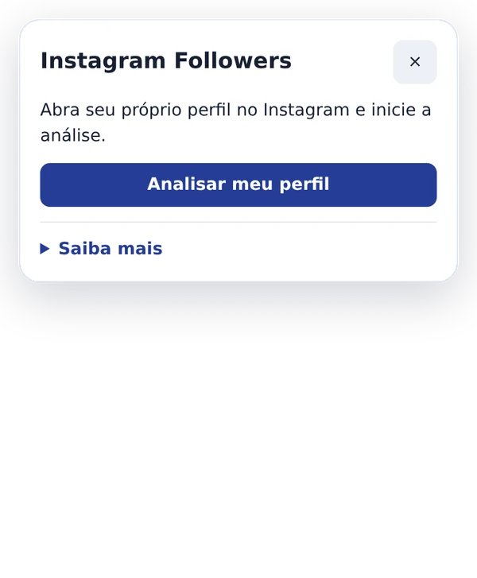
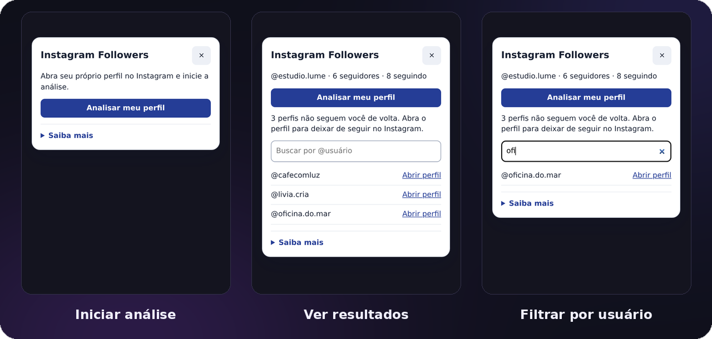

  

  <a href="#instalar-no-chrome"><b>Instalar no Chrome</b></a>
  &nbsp;·&nbsp; gratuito e de código aberto &nbsp;·&nbsp; análise no navegador

Instagram Followers é uma extensão para Chrome que mostra quais contas você segue no Instagram e
não seguem você de volta. É só abrir seu perfil e clicar em **Analisar meu perfil**. A extensão
usa a sessão já aberta, sem pedir senha ou importar um ZIP.

  

## O que aparece na lista

  

Uma aba da extensão acompanha a análise desde o início e mostra eventuais erros. Quando a leitura
termina, essa aba abre em primeiro plano com os perfis que não seguem você de volta e a busca por
`@usuário`. Para revisar
uma conta, clique em **Abrir perfil**. Se quiser deixar de seguir, confirme a ação no próprio
Instagram. Rode a análise de novo para conferir mudanças desde a última leitura.

## Instalar no Chrome

1. Clone este repositório ou [baixe o código em ZIP](https://github.com/rmgladius/instagram-followers/archive/refs/heads/main.zip) e extraia a pasta.
2. Abra `chrome://extensions` e ative o **Modo do desenvolvedor**.
3. Clique em **Carregar sem compactação** e selecione a pasta que contém o `manifest.json`.
4. Entre no Instagram, abra seu próprio perfil e clique no ícone do **Instagram Followers**.
5. Clique em **Analisar meu perfil** e mantenha a aba aberta até a leitura terminar.

Já instalou a extensão? Ao atualizar os arquivos da pasta, clique em **Recarregar** no cartão da
extensão em `chrome://extensions` e atualize a aba do Instagram.

## Saiba mais

### Por dentro

A extensão abre as listas de **Seguidores** e **Seguindo** e compara os nomes de usuário. Ela só
mostra o resultado quando o número de contas coletadas em cada lista bate com o total exibido pelo
Instagram.

A permissão `activeTab` dá acesso temporário à aba quando você clica no ícone. A permissão
`scripting` permite abrir o painel e ler as listas na página. A análise roda no navegador e seus
resultados ficam na memória do Chrome (`storage.session`) até você fechar a aba de resultados ou
encerrar a sessão do navegador. Se o Instagram recarregar depois que a lista de seguidores foi
conferida, a extensão mantém essa etapa e tenta retomar a leitura de quem você segue. A extensão
não envia as listas a servidores.

JavaScript · HTML · CSS · Chrome Extensions Manifest V3

### Se a análise não terminar

- Confirme que está no seu próprio perfil e feche outras janelas abertas na página.
- Se o painel pedir ajuda para carregar a lista, role o modal do Instagram lentamente até o fim.
  A extensão continua lendo e mantém as contas que já conferiu.
- Se o Instagram mostrar apenas um total abreviado ou mudar a forma de exibir as listas, a extensão
  pode não conseguir conferir a leitura. Nesse caso, ela avisa e omite os resultados parciais.

---

Feito por [Rodrigo Dias](https://github.com/rmgladius). Código aberto sob a [licença MIT](LICENSE).
Projeto independente, sem vínculo com o Instagram ou a Meta.
