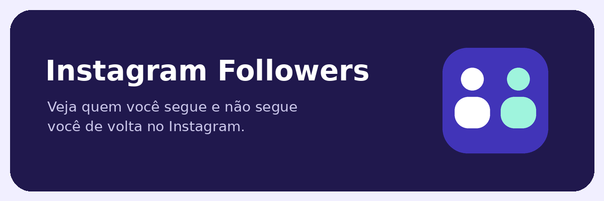

# Instagram Followers

Extensão para Chrome que mostra quais contas você segue no Instagram e não seguem você de volta. A comparação roda no navegador usando sua sessão aberta, sem pedir senha ou importar um ZIP.

## Instalação

1. Clone este repositório ou baixe o código e extraia os arquivos.
2. Abra `chrome://extensions` no Chrome e ative o **Modo do desenvolvedor**.
3. Clique em **Carregar sem compactação** e selecione a pasta que contém o `manifest.json`.

Se já tiver instalado a extensão, clique no botão de recarregar no cartão dela em `chrome://extensions`. Em seguida, recarregue a aba do Instagram.

## Uso

1. Entre no Instagram pelo Chrome e abra seu próprio perfil.
2. Clique no ícone da extensão **Instagram Followers** e depois em **Analisar meu perfil**.
3. Mantenha a aba aberta enquanto a extensão lê as duas listas. Use a busca para filtrar os resultados.
4. Clique em **Abrir perfil** e use **Deixar de seguir** no próprio Instagram quando quiser.

## Saiba mais

### Como a análise funciona

A extensão abre as listas de **Seguidores** e **Seguindo**, percorre as contas visíveis e compara os nomes de usuário. Ela só mostra o resultado quando a quantidade de contas coletadas em cada lista bate com o total exibido pelo Instagram. O resultado reflete aquela leitura. Para ver mudanças recentes, rode a análise novamente.

### Privacidade e permissões

O Chrome concede acesso temporário à aba do Instagram quando você aciona a extensão (`activeTab`). A permissão `scripting` permite abrir o painel e ler as listas na própria página. A análise usa sua sessão já aberta, sem pedir credenciais, importar arquivos ou enviar os resultados a servidores. Os dados da análise ficam em memória enquanto o painel estiver aberto.

### Se a análise não terminar

- Confirme que está no seu próprio perfil no Instagram e feche outras janelas abertas na página.
- Se uma lista parar de carregar, recarregue o perfil, reabra a extensão e tente novamente.
- Se o Instagram só mostrar um total abreviado ou mudar a interface, a extensão pode não conseguir verificar a lista. Nesse caso, ela avisa e omite o resultado para evitar indicar contas por engano.

Este projeto é independente e não tem vínculo com o Instagram ou a Meta.

## Licença

[MIT](LICENSE)
